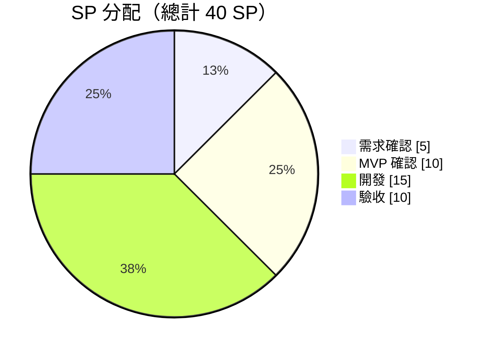
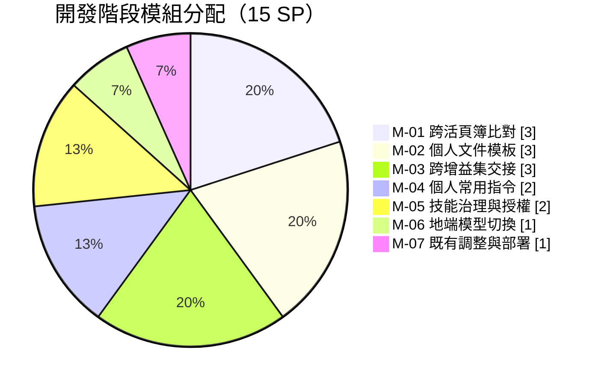
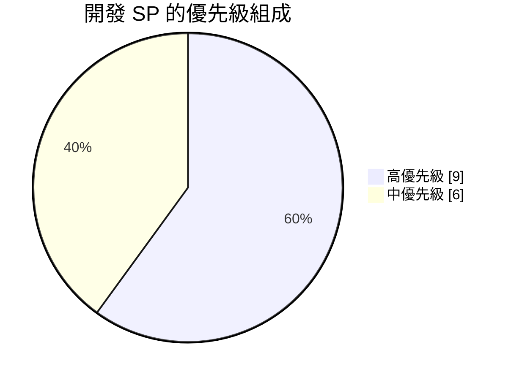

# SP 規劃書

**專案名稱**：JVision Office 增益集家族（Excel / Word / PowerPoint）
**版本**：v1.0
**日期**：2026-09-02
**對應規格**：[產品需求規格書（PRD）v1.2](PRD-JVision-Office.md)

---

## 1. SP 總點數

| 項目 | 數值 |
|------|------|
| 預估 SP | 40 SP |
| 確認 SP | 40 SP |
| 分配依據 | 依 PRD v1.2 第一階段範圍估算。本專案**不是從零開發**——Excel / Word / PowerPoint 三個增益集的主體、統一側邊欄框架與安裝程式已於技術原型（v0.1.0）完成並可運作，故開發點數集中在本次新增的功能模組與平台整合（見第 3、4 節）。驗收占比偏高，反映 PRD 已定義 50 條驗收標準（AC-01～AC-50）。 |

---

## 2. 各階段 SP 分配

| 階段 | SP 點數 | 占比 | 說明 |
|------|--------|------|------|
| 需求確認 | 5 SP | 12.5% | PRD 撰寫與兩輪客戶回覆收斂；7.2 待確認事項五項全數結案 |
| MVP 確認 | 10 SP | 25% | 架構定案：跨檔案比對途徑、跨增益集交接機制、技能治理邊界、個人資產（常用指令／模板）的儲存與隔離模型 |
| 開發 | 15 SP | 37.5% | 七個功能模組，明細見第 4 節 |
| 驗收 | 10 SP | 25% | 50 條驗收標準逐項驗證，含強茂環境實機確認與試行支援 |
| **合計** | **40 SP** | **100%** | |

**分配的邏輯**

- **需求＋MVP 合計 15 SP，與開發等量。** 本專案的難點不在寫程式，而在邊界的界定——哪些做、哪些不做、哪些改用替代做法。三項平台限制（跨活頁簿、跨主機驅動、SharedRuntime 版本）都必須先定案，開發才不會走回頭路。
- **驗收 10 SP 不是緩衝。** 50 條驗收標準中，有 12 條涉及權限隔離與注入防護（AC-16、AC-17、AC-36、AC-41～AC-43、AC-50 等），須以另一個使用者身分實際嘗試越權才能通過，無法靠功能測試順帶完成。

---

## 3. 本次開發的起點（既有基礎，不計入 15 SP）

下列能力已於技術原型完成並可運作，本次僅需維護與微調，**不重複計點**。這是開發階段只需 15 SP 的原因。

| 既有能力 | 狀態 |
|----------|------|
| 三個增益集主體（Excel / Word / PowerPoint 的文件讀寫工具集） | 已完成，共約 7,600 行 |
| 統一側邊欄外殼（對話、串流、歷史紀錄、語系、模型選單） | 已完成 |
| 確認閘門與寫入前快照復原 | 已完成，三個主機皆有 |
| 引用定位（點擊回跳儲存格／段落／投影片） | 已完成 |
| AD 網域登入與 LDAP 驗證串接 | 已完成 |
| 附件上傳與解析（PDF／Word／Excel／CSV／圖片） | 已完成 |
| 安裝程式（單一 .exe、免管理員權限、靜默參數） | 已完成，待簽章 |

---

## 4. 主要開發模組（15 SP）

| 編號 | 模組名稱 | 功能說明 | 預估 SP | 優先級 | 對應 PRD |
|------|----------|---------|--------|--------|---------|
| M-01 | 跨活頁簿／跨檔案比對 | 將當下活頁簿與另一份 Excel／PDF／Word／CSV 比對差異，結果輸出為新工作表；來源檔唯讀 | 3 SP | 高 | 3.2、AC-40 |
| M-02 | 個人文件模板 | 上傳、版本更新與回復、套用至 Word／PowerPoint 生成；僅本人可見 | 3 SP | 高 | 3.5、3.3、3.4、AC-47～50 |
| M-03 | 跨增益集交接 | Excel 分析結果打包為交接包，於 PowerPoint／Word 側邊欄接手原生生成 | 3 SP | 中 | 3.5、AC-44～46 |
| M-04 | 個人常用指令 | 儲存常用提示詞、一鍵套用；純文字不綁工具，執行權限等同使用者既有權限 | 2 SP | 高 | 3.5、AC-42～43 |
| M-05 | 技能治理與授權 | 技能由強合 IT 上架；強茂 IT 可指派 AD 群組與停用；越權呼叫拒絕並記錄 | 2 SP | 中 | 3.5、AC-41 |
| M-06 | 地端模型切換與降級 | 依群組或敏感等級指定走地端或雲端；地端不可用時依政策切換或拒絕，不得靜默降級 | 1 SP | 中 | 3.6、AC-18～19 |
| M-07 | 既有增益集調整與部署收尾 | 登入收斂為僅 AD、附件欄位調整、程式碼簽章導入、Intune／GPO 靜默派送驗證 | 1 SP | 高 | 3.1、3.8、AC-27、AC-32 |
| | **合計** | | **15 SP** | | |

### 模組點數的估算理由

| 編號 | 為何是這個點數 |
|------|----------------|
| M-01 | 附件上傳與解析已存在，本模組是**比對邏輯與差異工作表輸出**；不含第二階段的即時讀取 |
| M-02 | 三項工作疊加：檔案上傳與保存、版本更新與回復、套用至兩個主機的生成流程 |
| M-03 | 需新增平台端交接包儲存（綁使用者、24 小時失效），三個主機各加一個工具與接手 UI |
| M-04 | 純文字的儲存與套用，不涉及工具綁定與權限判定，是本次最單純的模組 |
| M-05 | 主要工作在平台端的授權對應與 API 阻擋，增益集端僅需技能下拉清單 |
| M-06 | 平台端能力，增益集端的模型選單已存在，本次僅補降級提示 |
| M-07 | 皆為既有功能的收斂與流程對接，非新建 |

### 依優先級彙總

| 優先級 | 模組 | SP 小計 | 占開發階段 |
|--------|------|--------|-----------|
| 高 | M-01、M-02、M-04、M-07 | 9 SP | 60% |
| 中 | M-03、M-05、M-06 | 6 SP | 40% |
| 低 | — | 0 SP | 0% |

---

## 5. 模組交付順序與相依

| 批次 | 模組 | 為何排這個順序 |
|------|------|----------------|
| 第 1 批 | M-07、M-04 | 兩者無前置相依。M-07 先做可讓試行環境及早就緒；M-04 最單純，適合先驗證「個人資產存平台端」的儲存與隔離模型 |
| 第 2 批 | M-01、M-05 | M-01 承接既有附件機制；M-05 的授權模型與 M-04 共用同一套個人／企業範圍判定 |
| 第 3 批 | M-02、M-03 | 兩者皆需寫入 Word／PowerPoint 並沿用既有版面樣式，實作面高度重疊，接續開發可共用同一批驗證 |
| 第 4 批 | M-06 | 平台端獨立作業，不阻擋其他模組，可與驗收並行 |

**關鍵相依**：M-04 建立的「個人資產隔離模型」（僅本人可見、跨入口一致、稽核記錄）是 M-02 的前置。若 M-04 延後，M-02 會連帶延後。

---

## 6. 第二階段模組（不計入本次 40 SP）

| 模組名稱 | 功能說明 | 為何不在本次 |
|----------|---------|-------------|
| 跨活頁簿即時讀取 | 於來源活頁簿也開啟側邊欄並向平台註冊，AI 可派送讀取指令至指定窗格；來源檔完全不離開本機 | 需將平台端橋接由「一次執行↔一條連線」改為「一次對話↔多窗格路由」 |
| JVision for Outlook | 郵件側邊欄：草擬回信、彙整信件串、抽取待辦事項 | 待三個 Office 增益集穩定後再擴充入口 |

---

## 7. SP 風險

| 風險 | 影響模組 | 影響 | 因應 |
|------|---------|------|------|
| 強茂環境（Office LTSC 2024）實機驗證未通過 | 全部 | 高 | 試行首日即以本產品實機確認，不等到開發後期。LTSC 為凍結版本，若有介面缺口需及早改用替代做法 |
| 模板套用的還原度不如預期 | M-02 | 中 | 先以單一模板做還原度驗證，確認後再展開版本管理功能 |
| 交接包的內容範圍談不攏 | M-03 | 中 | MVP 階段先以「結論摘要＋數據表」定案，圖表與引用位置列為可選 |
| 權限隔離類驗收（12 條）耗時超估 | 驗收 | 中 | 於各模組開發完成時即進行該模組的隔離驗證，不累積到驗收階段 |
| 程式碼簽章憑證作業延誤 | M-07 | 低 | 已確認強茂有簽章 Server 與窗口；備援為將 exe 加入白名單 |
